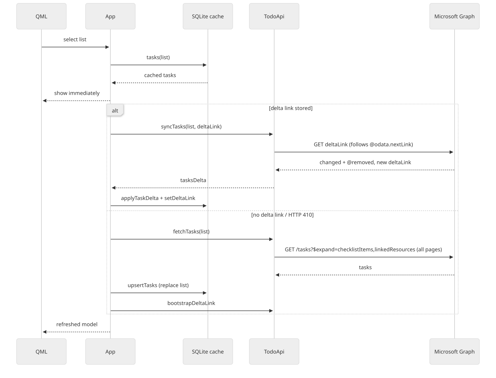
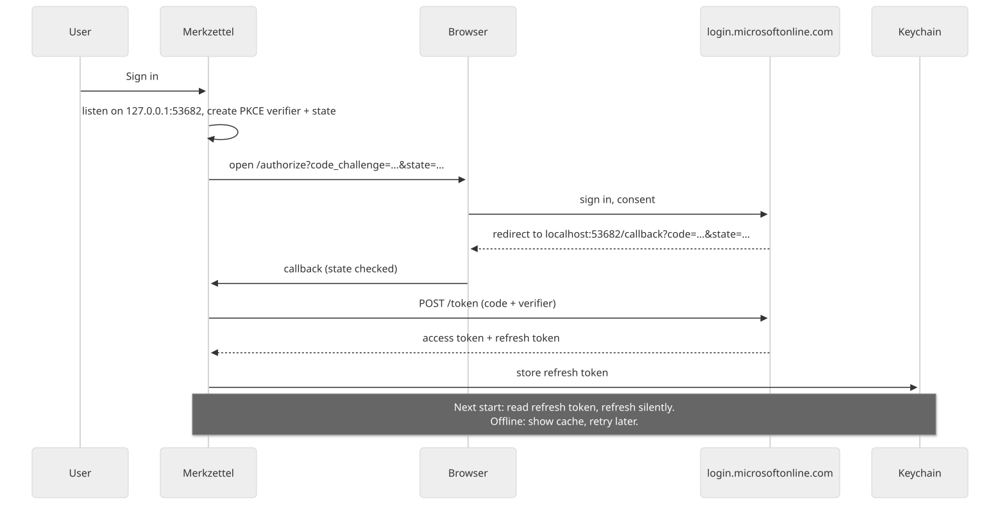

# Architektur

Merkzettel ist eine Qt-6-Anwendung in einem einzigen Prozess. Die gesamte
Anwendungslogik läuft im GUI-Thread; Netzwerkzugriffe laufen asynchron über
`QNetworkAccessManager`, und der SQLite-Cache ist klein genug, um synchron
genutzt zu werden. Es gibt also keinen geteilten Zustand zwischen Threads.

## Komponenten

| Teil | Dateien | Aufgabe |
|---|---|---|
| Einstiegspunkt | `src/main.cpp` | `KAboutData`, einzelne Instanz (`KDBusService`), Umzug alter Datenpfade, QML-Engine |
| Controller | `src/app.{h,cpp}` | Für QML als `app` sichtbar: leitet UI-Aktionen an Graph und den Cache weiter, Zeitfenster für Rückgängig, Mein Tag, Demo-Modus |
| Authentifizierung | `src/auth/` | OAuth-2.0-Autorisierungscode-Ablauf mit PKCE (QtNetworkAuth), Loopback-Weiterleitung, Refresh-Token über QtKeychain |
| Graph-Client | `src/graph/graphclient.*` | Anfragewarteschlange (max. 4 gleichzeitig), Retry-After-Wartezeit bei 429/503, Token-Erneuerung bei 401, Rohdaten-Downloads und Upload-Session-Blöcke |
| To-Do-API | `src/graph/todoapi.*` | Listen, Aufgaben, Schritte, verknüpfte Ressourcen, Anhänge, Delta-Synchronisierung, Paginierung, Verschieben per Kopie |
| Cache | `src/cache/database.*` | SQLite: Listen, Aufgaben, Schritte, verknüpfte Ressourcen, Delta-Links, Mein Tag; Schema-Aktualisierung mit `ALTER TABLE` |
| Modelle | `src/models/` | `TaskListsModel` (Smart-Listen + Listen), `TasksModel` (Filter, Sortierung, Abschnitte, ausgeblendete, noch nicht ausgeführte Löschungen) |
| Hilfsfunktionen | `src/util/dateparser.*` | Datumswörter in der Eingabezeile |
| Oberfläche | `src/*.qml` | Kirigami-Seiten, Detailansicht, Dialoge |
| Systemabschnitt | `src/tray/` | `KStatusNotifierItem` mit Zähler der heute fälligen Aufgaben |

`merkzettel_core` (Authentifizierung, Graph, Cache, Modelle, Hilfsfunktionen)
und `merkzettel_app` (Controller, Systemabschnitt) sind statische Bibliotheken;
das ausführbare Programm fügt nur `main.cpp` hinzu. Die Tests linken dieselben
Bibliotheken.

## Synchronisierung

- Die Oberfläche zeigt immer zuerst den Cache und aktualisiert, sobald Graph
  antwortet.
- Listen mit gespeichertem Delta-Link werden inkrementell synchronisiert; ein
  abgelaufenes Delta-Token (HTTP 410) führt zu einem vollständigen Abruf.
- Ein vollständiger Abruf folgt jedem `@odata.nextLink`, bevor er die Liste im
  Cache ersetzt.
- Änderungen werden als PATCH nur des geänderten Felds gesendet (pro Feld
  gewinnt die letzte Änderung, siehe `DECISIONS.md` D11).
- Löschen und Verschieben werden lokal ausgeblendet und nach einem
  sechssekündigen Zeitfenster für Rückgängig gesendet.

## Anmeldung

Ein gespeichertes Refresh-Token gilt als „angemeldet“: Das Fenster zeigt
sofort die zwischengespeicherten Daten, und die Synchronisierung beginnt,
sobald eine Token-Erneuerung gelingt. Netzwerkfehler bei der Erneuerung
behalten die Sitzung und versuchen es erneut (jede Minute und sobald
`QNetworkInformation` eine Verbindung meldet); `invalid_grant` beendet die
Sitzung.

## Hinweise zur Sicherheit

- Text aus Aufgaben wird nie als Rich Text dargestellt (`Text.PlainText` oder
  `App::plain()`), damit Inhalte geteilter Listen kein Markup einschleusen
  oder entfernte Bilder laden können.
- Nur Verknüpfungen mit `https`, `http`, `mailto` und `file` werden geöffnet.
- Cache- und Anhangsverzeichnisse sind nur für den Benutzer zugänglich.
- Siehe [`SECURITY.md`](https://github.com/mzilinski/merkzettel/blob/main/SECURITY.md).

## Entscheidungen

Designentscheidungen (App-ID, Umgang mit der Client-ID, Lizenzen,
Offline-Verhalten, …) stehen in
[`DECISIONS.md`](https://github.com/mzilinski/merkzettel/blob/main/DECISIONS.md).
