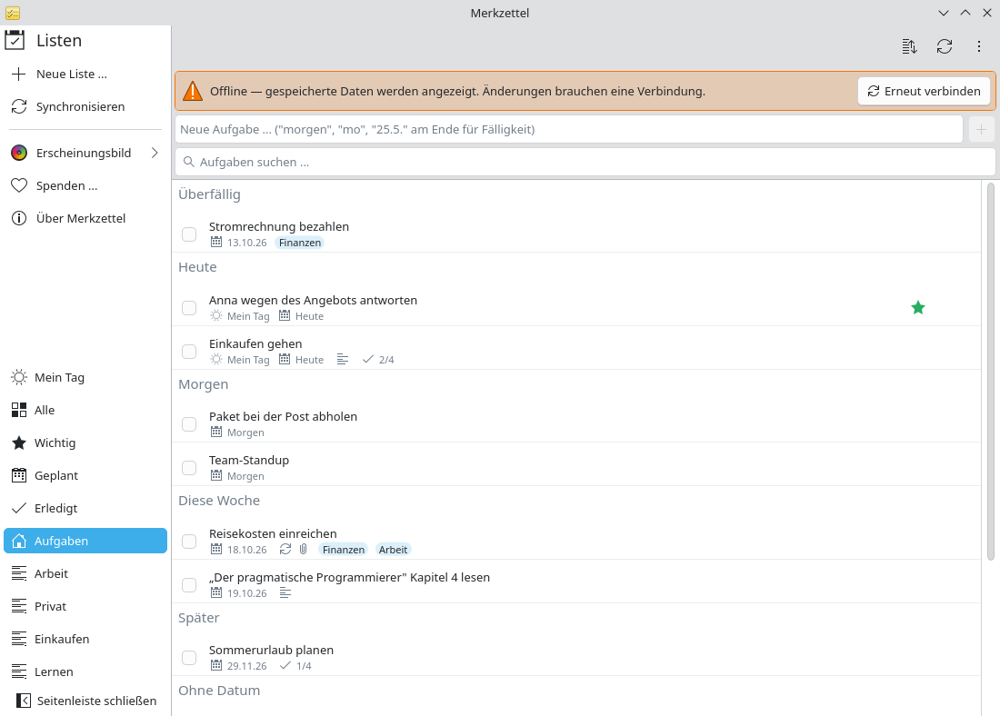

# Offline unterwegs

**Problem:** Im Zug oder im Flugzeug hast du keine zuverlässige Verbindung,
willst aber trotzdem sehen, was auf deiner Liste steht.

**Lösung:** Merkzettel hält eine lokale Kopie aller Listen. Er startet ohne
Netz, zeigt die gespeicherten Daten und verbindet sich später von selbst neu.

<video controls preload="none" width="100%" poster="/merkzettel/videos/offline-de.jpg">
  <source src="/merkzettel/videos/offline-de.mp4" type="video/mp4">
  <track kind="subtitles" srclang="de" label="Deutsch" src="/merkzettel/videos/offline-de.vtt" default>
</video>

## Schritte

1. **Bevor du losfährst,** öffne Merkzettel einmal mit Verbindung. Er
   aktualisiert die Kopie jeder Liste, die du öffnest; *Alle* aktualisiert alle
   Listen auf einmal.
2. **Offline** startest du Merkzettel wie gewohnt. Ein Hinweis sagt dir, dass
   du offline bist; alle Listen, Aufgaben, Schritte, Notizen und Kategorien
   sind da.

    { .screenshot }

3. **Lesen und planen.** Suche, Sortierung und Mein Tag funktionieren offline.
   Änderungen an Aufgaben brauchen eine Verbindung; Merkzettel sagt dir, wenn
   eine fehlschlägt.
4. **Wieder online** verbindet sich Merkzettel von selbst (oder du wählst
   **Erneut verbinden**) und holt alles, was sich in der Zwischenzeit geändert
   hat.

## Gut zu wissen

- Anhänge werden beim Öffnen heruntergeladen und brauchen deshalb eine
  Verbindung.
- Merkzettel merkt sich offline vorgenommene Änderungen nicht vor; halte sie in
  Mein Tag fest oder versuch es erneut, sobald du verbunden bist.
