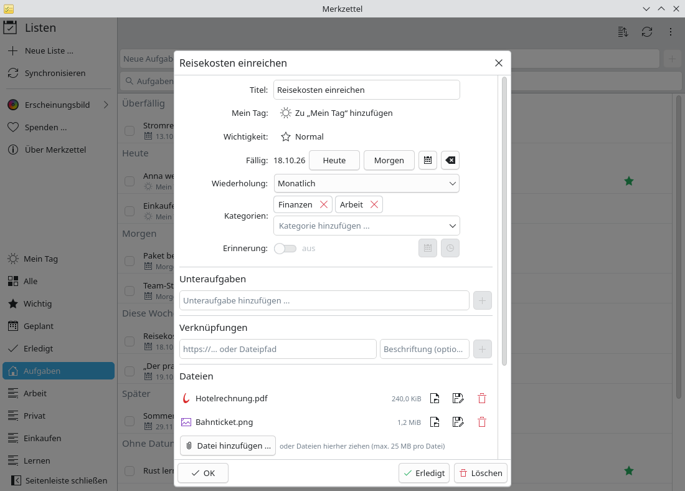

# Aufgaben organisieren: Anhänge, Kategorien, Wiederholung

**Problem:** Manche Aufgaben brauchen mehr als einen Titel: den Beleg für die
Reisekostenabrechnung, eine Kategorie, um alle Finanzaufgaben zu finden, eine
Erinnerung, die jeden Monat wiederkommt.

**Lösung:** Die Aufgabendetails enthalten Dateien, Kategorien, Wiederholung
und Erinnerungen – synchronisiert mit Microsoft To Do.

<video controls preload="none" width="100%" poster="/merkzettel/videos/organise-tasks-de.jpg">
  <source src="/merkzettel/videos/organise-tasks-de.mp4" type="video/mp4">
  <track kind="subtitles" srclang="de" label="Deutsch" src="/merkzettel/videos/organise-tasks-de.vtt" default>
</video>

## Schritte

1. **Öffne die Aufgabe** mit einem Klick oder <kbd>Eingabe</kbd>.

    { .screenshot }

2. **Dateien anhängen:** Ziehe sie aus Dolphin auf *Dateien* oder wähle
   **Datei hinzufügen ...**. Bis 25 MB pro Datei. **Öffnen** zeigt eine Datei
   mit ihrer Anwendung, **Speichern unter ...** legt eine Kopie ab.
3. **Kategorien hinzufügen:** Tippe einen Namen in *Kategorien* und drücke
   <kbd>Eingabe</kbd>, oder wähle einen, den du schon benutzt hast. Das
   Suchfeld findet Aufgaben nach Kategorie.
4. **Wiederholung einstellen:** Wähle unter *Wiederholung* *Monatlich* (oder
   täglich, werktags, wöchentlich, jährlich). **Benutzerdefiniert ...** erlaubt
   Regeln wie *alle 2 Wochen am Montag und Donnerstag*. Erledigst du eine
   wiederkehrende Aufgabe, entsteht die nächste.
5. **Erinnerung setzen:** Schalte *Erinnerung* ein und wähle Datum und
   Uhrzeit. Die Desktop-Benachrichtigung hat einen Knopf **Erledigt**.

## Gut zu wissen

- Kategorien sind Outlook-Kategorien. Merkzettel zeigt ihre Namen; die Farben
  werden in Outlook festgelegt.
- Verschiebst du eine Aufgabe in eine andere Liste, bleiben Dateien, Schritte
  und Verknüpfungen erhalten.
