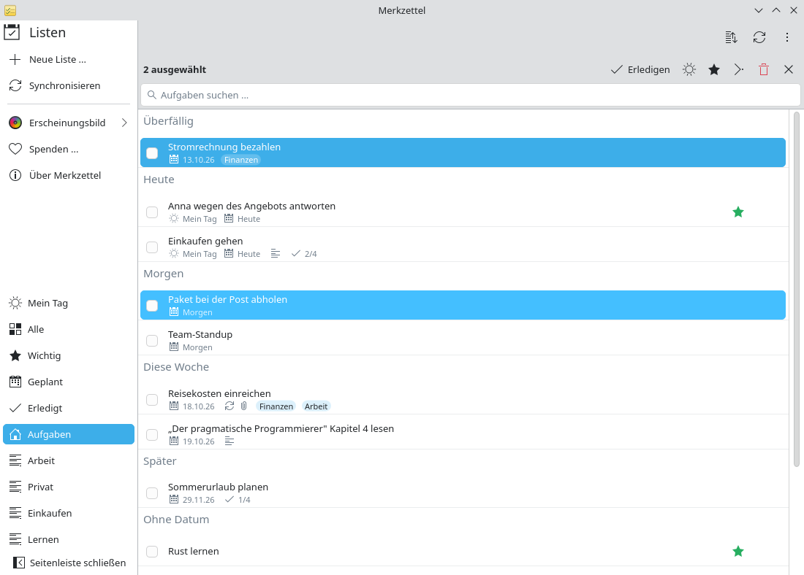
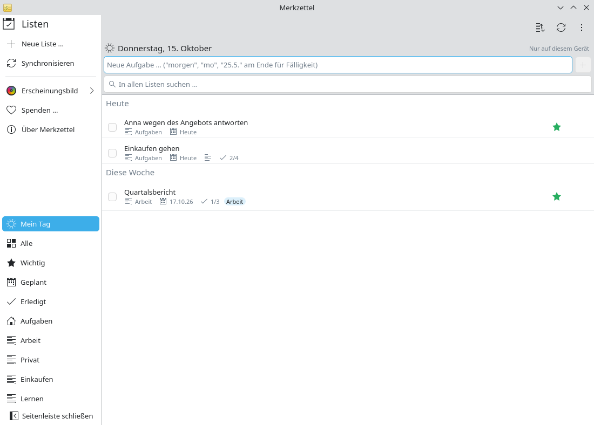

# Den Tag planen

**Problem:** Deine Listen enthalten Dutzende Aufgaben mit und ohne
Fälligkeit. Morgens willst du sehen, was heute zählt – und sonst nichts.

**Lösung:** Abschnitte nach Fälligkeit zeigen, was überfällig, heute oder
diese Woche fällig ist; **Mein Tag** enthält genau die Aufgaben, die du für
heute auswählst.

<video controls preload="none" width="100%" poster="/merkzettel/videos/plan-your-day-de.jpg">
  <source src="/merkzettel/videos/plan-your-day-de.mp4" type="video/mp4">
  <track kind="subtitles" srclang="de" label="Deutsch" src="/merkzettel/videos/plan-your-day-de.vtt" default>
</video>

## Schritte

1. **Sieh dir die Abschnitte an.** Jede Liste gruppiert Aufgaben in
   *Überfällig*, *Heute*, *Morgen*, *Diese Woche*, *Später* und *Ohne Datum*.
2. **Prüfe die Smart-Listen.** *Geplant* zeigt alles mit Fälligkeit aus allen
   Listen, *Wichtig* alles mit Stern.
3. **Wähle die Aufgaben für heute.** Markiere eine Aufgabe und drücke
   <kbd>Strg</kbd>+<kbd>T</kbd>, oder Rechtsklick → **Zu „Mein Tag“
   hinzufügen**. Mehrere auf einmal: Wähle sie mit <kbd>Strg</kbd>+Klick aus
   und nutze den Sonnen-Knopf in der Auswahlleiste.

    { .screenshot }

4. **Arbeite aus Mein Tag heraus.** Wähle *Mein Tag* in der Seitenleiste.
   Erledige Aufgaben mit dem Kästchen oder <kbd>Strg</kbd>+<kbd>D</kbd>.

    { .screenshot }

5. **Morgen geht es frisch los.** Mein Tag leert sich über Nacht; unerledigte
   Aufgaben bleiben mit ihrer Fälligkeit in ihren Listen.

!!! info "Hinweis"
    Mein Tag wird nur auf diesem Computer gespeichert, weil Microsoft es
    anderen Apps nicht anbietet ([FAQ](../faq.md#my-day)).
