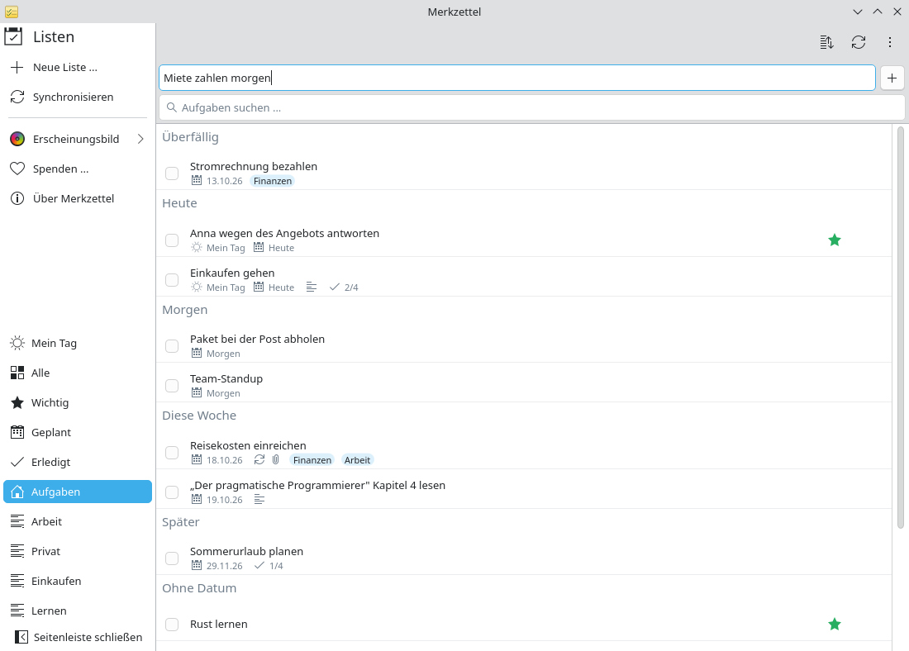

# Aufgaben von überall erfassen

**Problem:** Dir fällt eine Aufgabe ein, während du eine E-Mail schreibst oder
eine Webseite liest. Zum To-Do-Tab wechseln, die richtige Liste suchen und
alles eintippen reißt dich aus der Arbeit.

**Lösung:** Ein globaler Kurzbefehl holt Merkzettel nach vorn, mit dem Cursor
im Feld für neue Aufgaben; ein Datumswort am Ende setzt die Fälligkeit.

<video controls preload="none" width="100%" poster="/merkzettel/videos/quick-capture-de.jpg">
  <source src="/merkzettel/videos/quick-capture-de.mp4" type="video/mp4">
  <track kind="subtitles" srclang="de" label="Deutsch" src="/merkzettel/videos/quick-capture-de.vtt" default>
</video>

## Schritte

1. **Lass Merkzettel im Systemabschnitt laufen.** Das Schließen des Fensters
   versteckt ihn nur; das Symbol zeigt, wie viele Aufgaben heute fällig sind.
   Starte ihn mit deiner Sitzung (*Systemeinstellungen → Autostart*), dann ist
   er immer bereit.
2. **Drücke <kbd>Meta</kbd>+<kbd>Alt</kbd>+<kbd>N</kbd>** in einer beliebigen
   Anwendung. Merkzettel kommt nach vorn, das Feld für neue Aufgaben hat den
   Fokus.
3. **Tippe die Aufgabe mit einem Datumswort**, zum Beispiel
   `Miete zahlen morgen` oder `Anna anrufen fr`, und drücke
   <kbd>Eingabe</kbd>.

    { .screenshot }

4. **Verstecke das Fenster wieder** mit dem Schließen-Knopf; du bist wieder
   dort, wo du warst.

## Datumswörter

| Am Ende des Titels | Fällig |
|---|---|
| `heute`, `today` | heute |
| `morgen`, `tomorrow` | morgen |
| `übermorgen` | in zwei Tagen |
| `mo` … `so`, `montag` …, `mon` … `sun`, `monday` … | am nächsten solchen Wochentag |
| `25.5.`, `25.5.2027` | an diesem Datum |

Das Wort wird aus dem Titel entfernt. Fügst du eine Aufgabe hinzu, während
*Wichtig* gewählt ist, bekommt sie einen Stern; in *Geplant* ist sie heute
fällig; in *Mein Tag* landet sie in Mein Tag.

## Kurzbefehl ändern

*Systemeinstellungen → Tastatur → Kurzbefehle → Merkzettel → Aufgabe schnell
hinzufügen.*
