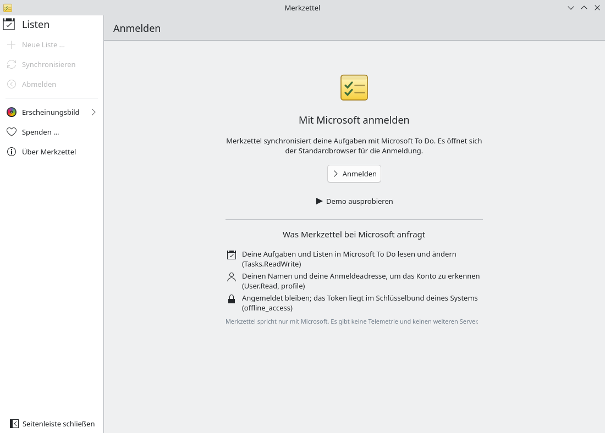
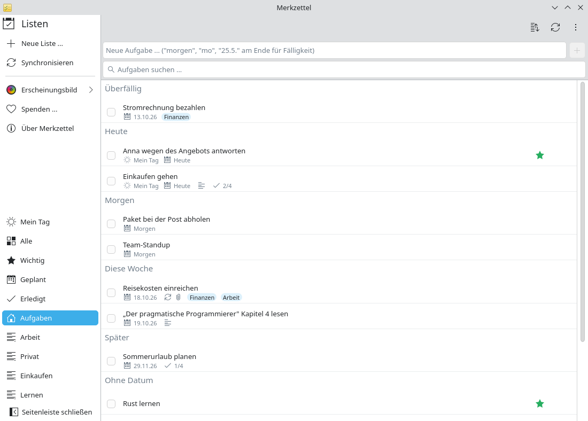

# Dienstkonto auf dem eigenen Linux-PC

**Problem:** Dein Arbeitgeber nutzt Microsoft 365. Du planst deine Arbeit auf
dem Handy in Microsoft To Do, aber auf deinem Linux-Desktop gibt es keine
To-Do-App – nur die Web-Version in einem Browser-Tab.

**Lösung:** Merkzettel meldet sich an deinem Konto von Arbeit oder Schule an
und zeigt dieselben Listen, nativ unter Plasma.

<video controls preload="none" width="100%" poster="/merkzettel/videos/work-account-de.jpg">
  <source src="/merkzettel/videos/work-account-de.mp4" type="video/mp4">
  <track kind="subtitles" srclang="de" label="Deutsch" src="/merkzettel/videos/work-account-de.vtt" default>
</video>

## Schritte

1. **Installiere Merkzettel** von Flathub oder aus dem AUR
   ([Installation](../installation.md)).
2. **Starte ihn** und wähle **Anmelden**. Dein Browser öffnet die
   Anmeldeseite von Microsoft.

    { .screenshot }

3. **Melde dich mit deiner Dienstadresse an** (name@firma.de). Nutze die
   Kontoauswahl, wenn du mit mehreren Konten angemeldet bist.
4. **Stimme den Berechtigungen zu.** Merkzettel fragt nur nach deinen
   Aufgaben, deinem Namen und danach, angemeldet zu bleiben. Siehst du
   *„Need admin approval“*, lies unten weiter.
5. **Fertig.** Deine Listen erscheinen, auch Listen, die Kollegen mit dir
   geteilt haben. Änderungen synchronisieren sich in beide Richtungen mit
   To Do auf dem Handy und im Web.

    { .screenshot }

## Wenn deine Organisation eine Freigabe verlangt

Manche Organisationen erlauben nur Apps, die die IT freigegeben hat. Microsoft
zeigt dann *„Need admin approval“*. Bitte deine IT-Abteilung, die App
**Merkzettel** für `Tasks.ReadWrite`, `User.Read` und `offline_access`
freizugeben oder sie in eurem Mandanten zu registrieren
([Azure-Einrichtung](../azure-setup.md)). Merkzettel greift nicht auf Mails,
Kalender oder Dateien zu.

## Gut zu wissen

- **Privates und Dienstkonto:** Merkzettel nutzt jeweils ein Konto. Melde dich
  ab und wieder an, um zu wechseln.
- **Die Regeln deines Arbeitgebers** für Microsoft 365 gelten auch für
  Merkzettel (bedingter Zugriff, Anmeldehäufigkeit). Meldet die Firma dich ab,
  bittet Merkzettel dich, dich erneut anzumelden.
- **Daten auf deinem PC:** Eine Kopie deiner Aufgaben liegt in deinem
  Home-Verzeichnis und ist nur für dich lesbar ([Datenschutz](../privacy.md)).
