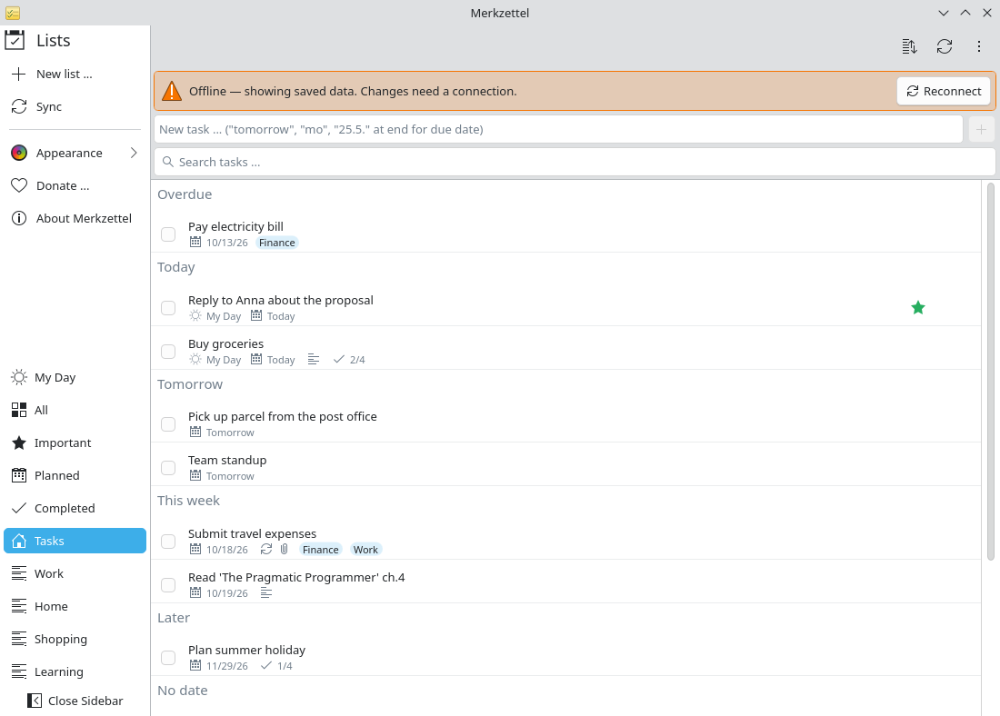

# Offline on the road

**Problem:** On the train or the plane you have no reliable connection, but
you still want to see what is on your list.

**Solution:** Merkzettel keeps a local copy of all lists. It starts without a
network, shows the saved data and reconnects by itself later.

<video controls preload="none" width="100%" poster="/merkzettel/videos/offline-en.jpg">
  <source src="/merkzettel/videos/offline-en.mp4" type="video/mp4">
  <track kind="subtitles" srclang="en" label="English" src="/merkzettel/videos/offline-en.vtt" default>
</video>

## Steps

1. **Before you leave,** open Merkzettel once while online. It updates the
   copy of every list you open; *All* updates all lists at once.
2. **Offline,** start Merkzettel as usual. A banner says you are offline; all
   lists, tasks, steps, notes and categories are there.

    { .screenshot }

3. **Read and plan.** Search, sort and My Day work offline. Changes to tasks
   need a connection; Merkzettel tells you if one fails.
4. **Back online,** Merkzettel reconnects on its own (or choose **Reconnect**)
   and fetches everything that changed meanwhile.

## Good to know

- Attachments are downloaded when you open them, so they need a connection.
- Merkzettel does not queue changes made offline; note them in My Day or try
  again once you are connected.
