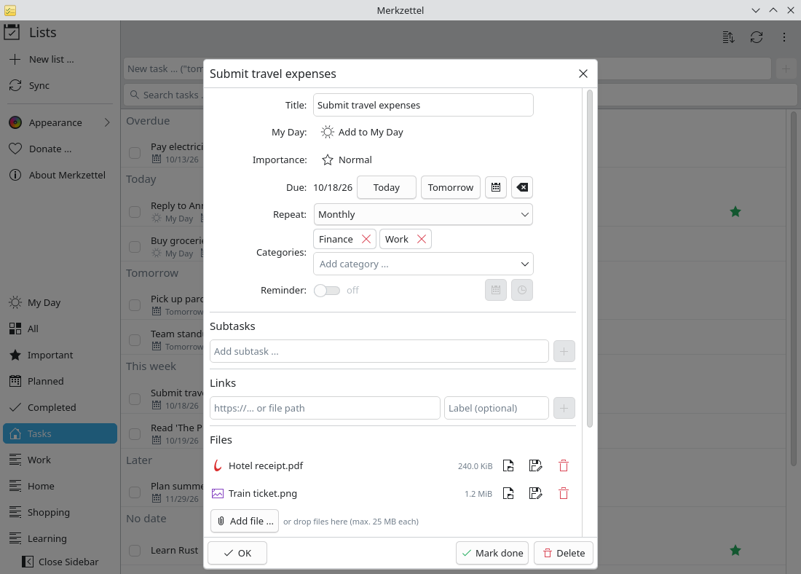

# Organise tasks: attachments, categories, recurrence

**Problem:** Some tasks need more than a title: the receipt for the expense
report, a category to find all finance tasks, a reminder that comes back every
month.

**Solution:** The task details hold files, categories, recurrence and
reminders — synchronised with Microsoft To Do.

<video controls preload="none" width="100%" poster="/merkzettel/videos/organise-tasks-en.jpg">
  <source src="/merkzettel/videos/organise-tasks-en.mp4" type="video/mp4">
  <track kind="subtitles" srclang="en" label="English" src="/merkzettel/videos/organise-tasks-en.vtt" default>
</video>

## Steps

1. **Open the task** with a click or <kbd>Enter</kbd>.

    { .screenshot }

2. **Attach files:** drag them from Dolphin onto *Files*, or choose
   **Add file …**. Up to 25 MB per file. **Open** shows a file with its
   application, **Save as …** stores a copy.
3. **Add categories:** type a name in *Categories* and press <kbd>Enter</kbd>,
   or pick one you used before. The search field finds tasks by category.
4. **Make it recurring:** choose *Monthly* (or daily, weekdays, weekly,
   yearly) under *Repeat*. **Custom …** allows rules like *every 2 weeks on
   Monday and Thursday*. Completing a recurring task creates the next one.
5. **Set a reminder:** switch *Reminder* on and pick date and time. The
   desktop notification has a **Mark done** button.

## Good to know

- Categories are Outlook categories. Merkzettel shows their names; colours are
  defined in Outlook.
- Moving a task to another list keeps its files, steps and links.
