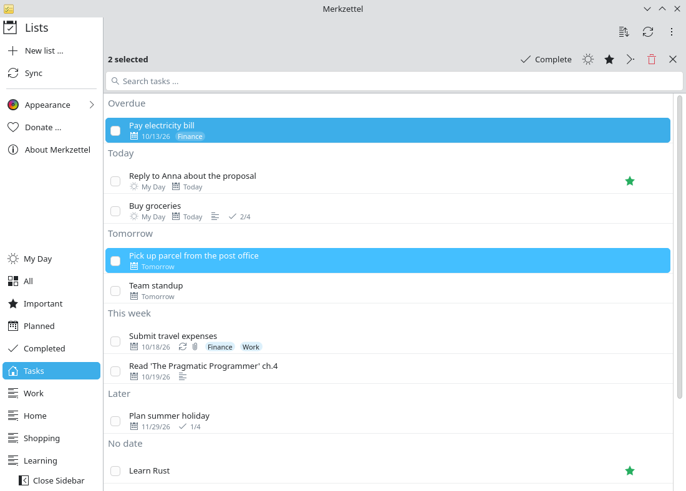
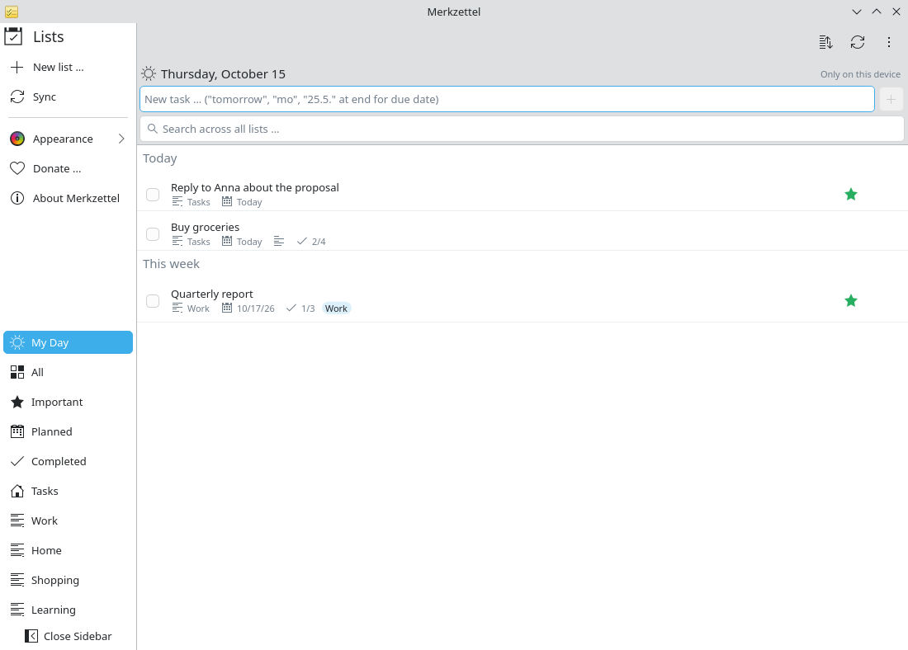

# Plan your day

**Problem:** Your lists contain dozens of tasks with and without due dates. In
the morning you want to see what matters today and nothing else.

**Solution:** Due-date sections show what is overdue, due today or this week;
**My Day** holds exactly the tasks you choose for today.

<video controls preload="none" width="100%" poster="/merkzettel/videos/plan-your-day-en.jpg">
  <source src="/merkzettel/videos/plan-your-day-en.mp4" type="video/mp4">
  <track kind="subtitles" srclang="en" label="English" src="/merkzettel/videos/plan-your-day-en.vtt" default>
</video>

## Steps

1. **Look at the sections.** Each list groups tasks into *Overdue*, *Today*,
   *Tomorrow*, *This week*, *Later* and *No date*.
2. **Check the smart lists.** *Planned* shows everything with a due date across
   all lists; *Important* everything with a star.
3. **Pick today's tasks.** Select a task and press <kbd>Ctrl</kbd>+<kbd>T</kbd>,
   or right-click → **Add to My Day**. Several at once: <kbd>Ctrl</kbd>+click
   them and use the sun button in the selection bar.

    { .screenshot }

4. **Work from My Day.** Select *My Day* in the sidebar. Complete tasks with
   the check box or <kbd>Ctrl</kbd>+<kbd>D</kbd>.

    { .screenshot }

5. **Tomorrow starts fresh.** My Day empties overnight; unfinished tasks stay
   in their lists with their due dates.

!!! info
    My Day is stored on this computer only, because Microsoft does not offer it
    to other apps ([FAQ](../faq.md#my-day)).
