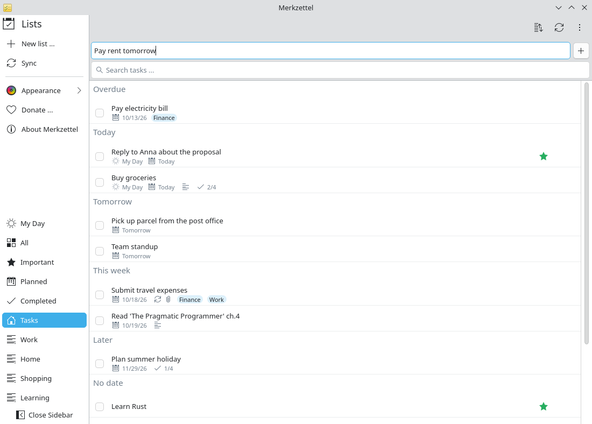

# Capture tasks from anywhere

**Problem:** A task occurs to you while you write an e-mail or read a web page.
Switching to the To Do tab, finding the right list and typing it in breaks your
flow.

**Solution:** One global shortcut brings Merkzettel up with the cursor in the
new-task field; a date word at the end sets the due date.

<video controls preload="none" width="100%" poster="/merkzettel/videos/quick-capture-en.jpg">
  <source src="/merkzettel/videos/quick-capture-en.mp4" type="video/mp4">
  <track kind="subtitles" srclang="en" label="English" src="/merkzettel/videos/quick-capture-en.vtt" default>
</video>

## Steps

1. **Keep Merkzettel in the tray.** Closing the window only hides it; the tray
   icon shows how many tasks are due today. Start it with your session
   (*System Settings → Autostart*) to always have it ready.
2. **Press <kbd>Meta</kbd>+<kbd>Alt</kbd>+<kbd>N</kbd>** in any application.
   Merkzettel comes to the front, the new-task field is focused.
3. **Type the task with a date word**, for example `Pay rent tomorrow` or
   `Call Anna fri`, and press <kbd>Enter</kbd>.

    { .screenshot }

4. **Hide the window again** with the close button; you are back where you were.

## Date words

| At the end of the title | Due |
|---|---|
| `today`, `heute` | today |
| `tomorrow`, `morgen` | tomorrow |
| `übermorgen` | in two days |
| `mon` … `sun`, `monday` …, `mo` … `so`, `montag` … | the next such weekday |
| `25.5.`, `25.5.2027` | that date |

The word is removed from the title. If you add a task while *Important* is
selected it is starred; in *Planned* it is due today; in *My Day* it lands in
My Day.

## Change the shortcut

*System Settings → Keyboard → Shortcuts → Merkzettel → Quick add task.*
