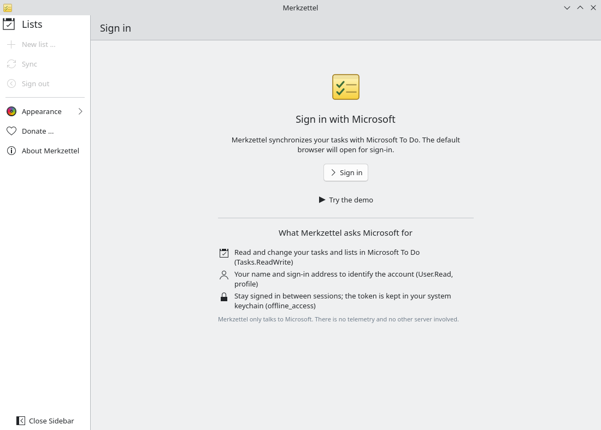
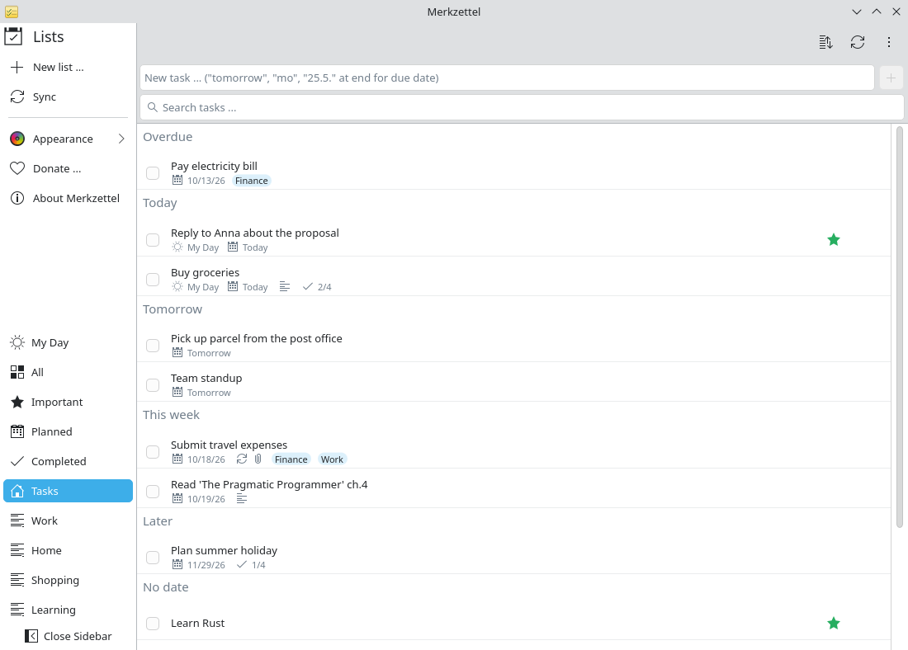

# Work account on your own Linux PC

**Problem:** Your employer uses Microsoft 365. You plan your work in Microsoft
To Do on the phone, but on your Linux desktop there is no To Do app — only the
web version in a browser tab.

**Solution:** Merkzettel signs in to your work or school account and shows the
same lists, natively on Plasma.

<video controls preload="none" width="100%" poster="/merkzettel/videos/work-account-en.jpg">
  <source src="/merkzettel/videos/work-account-en.mp4" type="video/mp4">
  <track kind="subtitles" srclang="en" label="English" src="/merkzettel/videos/work-account-en.vtt" default>
</video>

## Steps

1. **Install Merkzettel** from Flathub or the AUR ([Installation](../installation.md)).
2. **Start it** and choose **Sign in**. Your browser opens Microsoft's sign-in
   page.

    { .screenshot }

3. **Sign in with your work address** (name@company.com). Use the account
   picker if you are signed in with several accounts.
4. **Approve the permissions.** Merkzettel asks only for your tasks, your name
   and to stay signed in. If you see *"Need admin approval"*, see below.
5. **Done.** Your lists appear, including lists colleagues shared with you.
   Changes sync in both directions with To Do on the phone and the web.

    { .screenshot }

## If your organisation requires approval

Some organisations only allow apps approved by IT. Microsoft then shows
*"Need admin approval"*. Ask your IT department to approve the app
**Merkzettel** for `Tasks.ReadWrite`, `User.Read` and `offline_access`, or to
register it in your tenant ([Azure setup](../azure-setup.md)). Merkzettel does
not access mail, calendar or files.

## Good to know

- **Personal and work account:** Merkzettel uses one account at a time. Sign
  out and in again to switch.
- **Your employer's rules** for Microsoft 365 also apply to Merkzettel
  (conditional access, sign-in frequency). If the company signs you out,
  Merkzettel asks you to sign in again.
- **Data on your PC:** a copy of your tasks is stored in your home directory
  and readable only by you ([Privacy](../privacy.md)).
